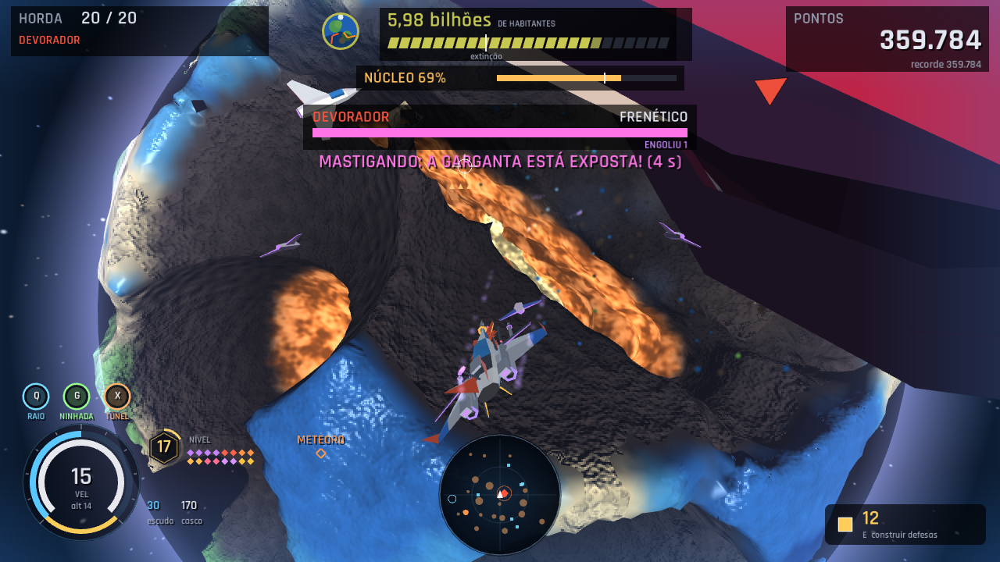
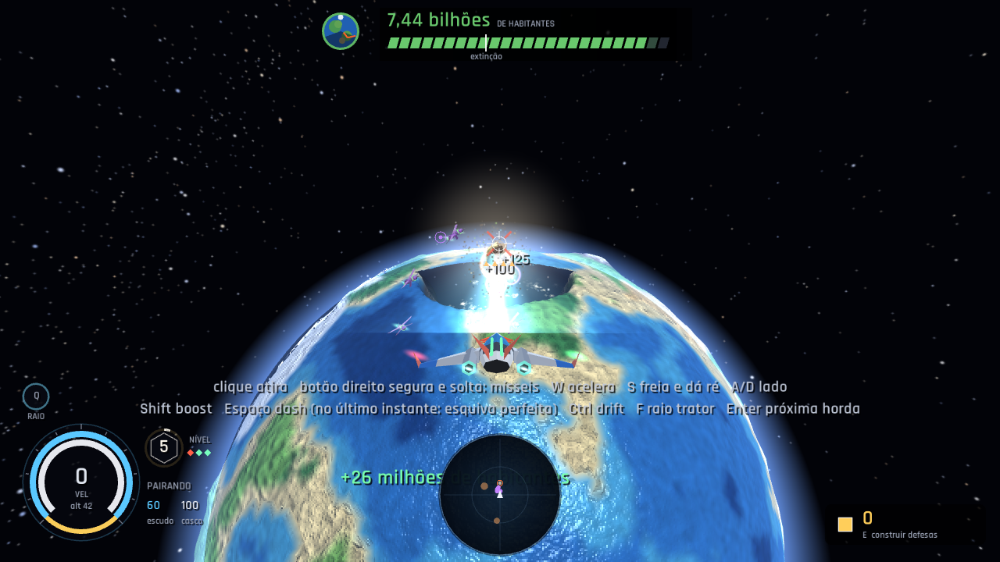
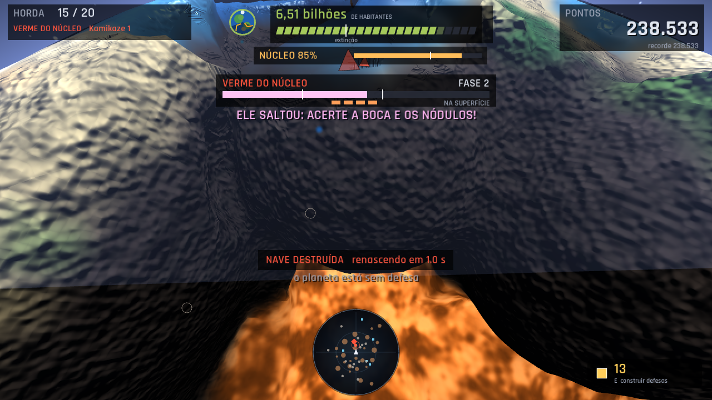

# Terra Fraturada

Jogo 3D de ação espacial escrito em **C puro** (C11 + [raylib](https://www.raylib.com/)). Você pilota uma nave em volta da Terra e a defende de hordas alienígenas e de quatro bosses. **O planeta é destrutível de verdade**: cada ataque arranca pedaços dele, e a vida do planeta é o volume que ainda resta. Crateras expõem o manto e o núcleo incandescente, e rochas arrancadas podem ser rebocadas de volta para consertar o terreno.



| | |
|---|---|
|  |  |

## Baixar e jogar

Baixe o pacote do seu sistema na página de [**Releases**](../../releases/latest):

- **Windows 10/11:** `TerraFraturada-windows.zip`. Descompacte e abra `TerraFraturada.exe`.
- **Linux (x86-64):** `TerraFraturada-linux.tar.gz`. Descompacte e rode `./TerraFraturada`.

Não precisa instalar nada. O `LEIA-ME.txt` dentro do pacote traz os controles.

### Online cooperativo (até 4 jogadores)

Windows e Linux jogam juntos. Um jogador cria a sala (**JOGAR ONLINE > CRIAR SALA**) e os outros entram pelo IP dele. Fora da mesma rede local, use uma rede virtual gratuita como o [ZeroTier](https://www.zerotier.com/) (Windows e Linux) ou o Radmin VPN (só Windows). Todos precisam da mesma versão do jogo.

O online é *lockstep*: cada computador roda a partida inteira e só os comandos trafegam. Por isso a simulação é determinística bit a bit, com trigonometria própria (`src/core/detmath.c`) em vez da biblioteca C de cada sistema. A CI compara a simulação do Windows com a do Linux a cada commit.

## Controles

| | Teclado e mouse | Controle |
|---|---|---|
| Mirar / voar | mouse, W/S, A/D | analógicos |
| Atirar / mísseis | clique / botão direito (segurar e soltar) | RT / LT |
| Boost / dash / drift | Shift / Espaço / Ctrl | L3 / A / B |
| Raio trator | F | X |
| Construir defesas | E, depois 1/2/3 | RB |
| Habilidades dos bosses | Q, G, X | LB, R3, direcional |
| Pausa | Esc | Start |

## Compilar

Precisa de `gcc`, `make` e `git` (o raylib 5.5 é baixado na primeira compilação).

**Windows** ([MSYS2](https://www.msys2.org/) UCRT64: `pacman -S mingw-w64-ucrt-x86_64-gcc mingw-w64-ucrt-x86_64-make`):

```
mingw32-make          # compila terra.exe
mingw32-make run      # compila e roda
mingw32-make test     # testes da lógica
```

**Linux** (Debian/Ubuntu):

```
sudo apt install build-essential git libx11-dev libxrandr-dev libxinerama-dev libxcursor-dev libxi-dev libgl1-mesa-dev
make && ./terra
make test
```

## Como o código está organizado

- `src/voxel/`: o planeta (campo de densidade 128³ em chunks, malha por *surface nets*, crateras, conserto)
- `src/game/`: a simulação (nave, inimigos, bosses, combate, hordas, evolução), sem depender do raylib
- `src/render/`, `src/ui/`, `src/audio/`: desenho, interface e áudio sintetizado em código (sem arquivos de som)
- `src/net/`: o online (UDP, lockstep)
- `data/*.txt`: números de ajuste, inimigos, hordas, bosses e evoluções (F5 relê com o jogo aberto)
- `tests/`: testes da lógica, ligados sem o raylib

As decisões técnicas estão em [`docs/decisoes.md`](docs/decisoes.md).

## Licenças de terceiros

- [raylib](https://github.com/raysan5/raylib): licença zlib
- Fonte [Rajdhani](https://fonts.google.com/specimen/Rajdhani): SIL Open Font License (`assets/fonts/Rajdhani-OFL.txt`)
